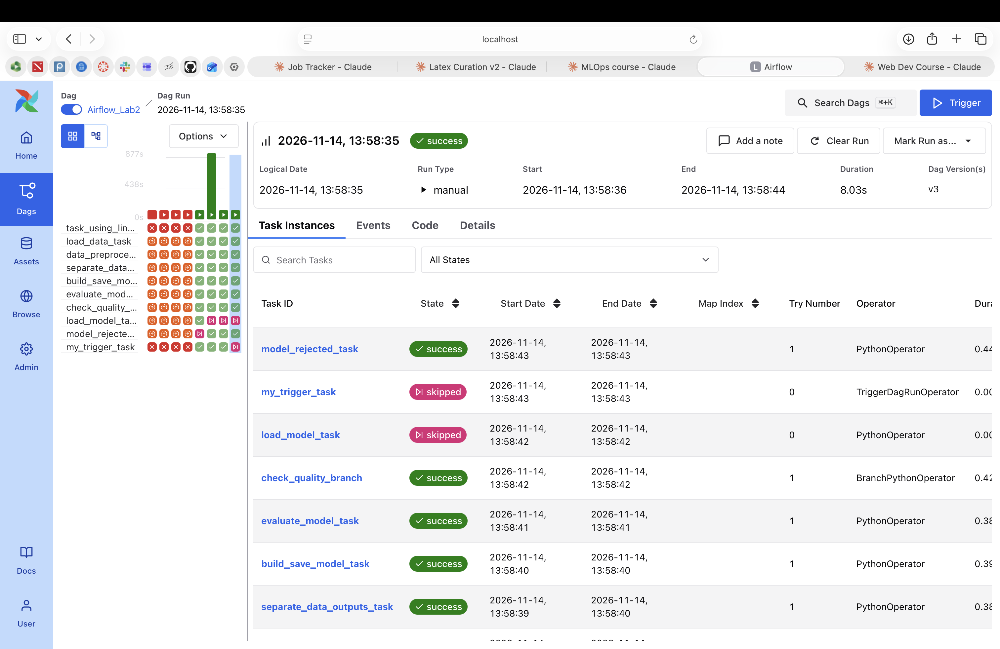
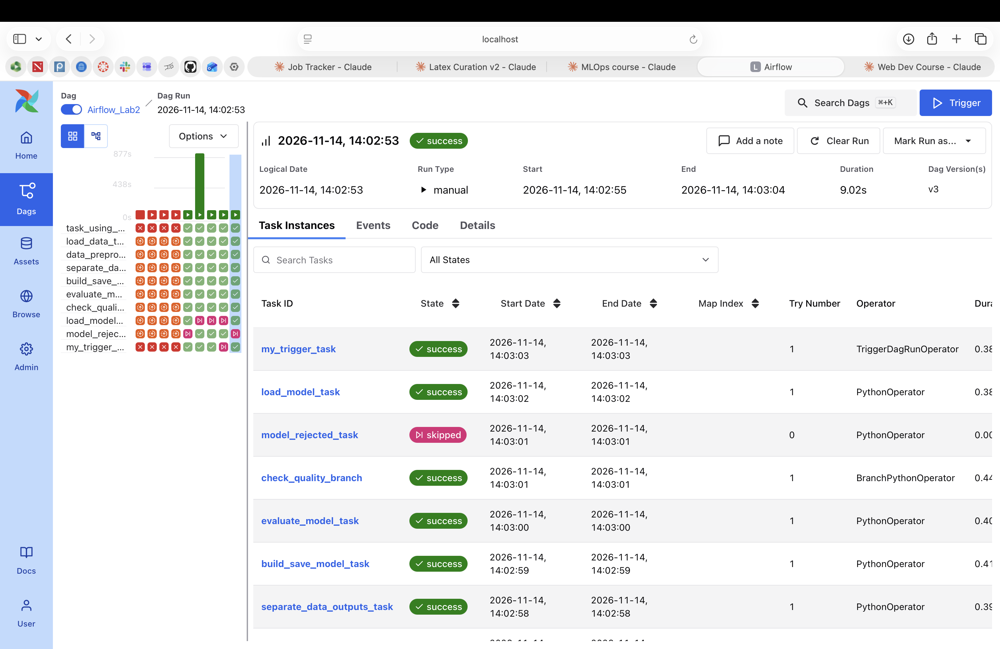

# MLOps Lab 4 - Airflow Orchestration: A Model Quality Gate via Branching

**Course:** DADS 7305 — MLOps, Northeastern University
**Original lab:** [`raminmohammadi/MLOps/Labs/Airflow_Labs/Lab_2`](https://github.com/raminmohammadi/MLOps/tree/main/Labs/Airflow_Labs/Lab_2)

## Overview

Two Airflow DAGs: `Airflow_Lab2` trains a classifier (advertising click-through
data) and, on completion, triggers `Airflow_Lab2_Flask`, which runs a small
Flask app reporting the pipeline's success/failure status via Airflow's own
REST API. The point of this lab is Airflow's **orchestration mechanism**
itself, task dependencies, branching, cross-DAG triggering not the model
or dataset.

## What's different from the original lab

### 1. A real quality gate, via Airflow's branching mechanism (core modification)

The original lab always proceeds from training straight to "serving"
(triggering the Flask status app), with no check on whether the model is
actually any good. This submission inserts a genuine decision point using
`BranchPythonOperator`:

```
... build_save_model_task → evaluate_model_task → check_quality_branch
                                                        ├─ (pass) → load_model_task → my_trigger_task
                                                        └─ (fail) → model_rejected_task
```

`check_quality_branch` compares the trained model's test score against a
threshold stored in an Airflow **Variable** (`MODEL_SCORE_THRESHOLD`), so it
can be changed from the UI without touching code. Only the passing branch
reaches `my_trigger_task`, the Flask status DAG is never triggered for a
rejected model. This mirrors the same "don't let a bad model through"
pattern used in this course's Docker lab (a build-stage gate) and MLflow lab
(a promotion gate), here expressed through Airflow's own branching
mechanism rather than a Docker build stage or a model registry alias.

**Tested evidence, this session:**

**Tested evidence, this session:**

- Threshold `0.99` (unreachable) → `check_quality_branch` routed to
  `model_rejected_task` (success); `load_model_task` and `my_trigger_task`
  both correctly show **skipped**, not failed or run:

  

- Threshold `0.85` → `check_quality_branch` routed to `load_model_task`
  (success) → `my_trigger_task` (success); `model_rejected_task` correctly
  shows **skipped**:

  

### 2. The missing notification, finally wired up (bug fix)

The original lab's README describes `notify_success`/`notify_failure`
callback functions and a `send_email` task none of which actually exist
anywhere in the DAG file it ships. The `EmailOperator` is fully commented
out. `src/quality_gate.py`'s `notify_rejection()` is what those
described-but-missing notifications actually look like, implemented for
real on the rejection path: it logs a clear rejection message and makes a
best-effort attempt to email via Airflow's configured SMTP settings,
wrapped in try/except so a missing SMTP config (an optional, external
dependency) doesn't fail the task itself.

### 3. Infrastructure built from scratch

The original lab ships **no `Dockerfile` and no `docker-compose.yaml`**,
both were written for this submission, targeting Airflow 3.0's
`LocalExecutor` + Postgres (rather than the full CeleryExecutor stack,
which this lab's scale doesn't need the same kind of scoping decision as
dropping Spark in the MLflow lab).

## Real bugs hit and fixed getting Airflow 3.0 running

Airflow 3.0 changed enough architecture that getting this actually running
surfaced several genuine, non-obvious issues, each fixed in order:

1. **`airflow users create` no longer exists.** Airflow 3.0 removed user
   management from the core CLI (AIP-56); a `SimpleAuthManager` now
   auto-generates an admin password instead, retrievable with
   `docker compose exec airflow-apiserver cat /opt/airflow/simple_auth_manager_passwords.json.generated`.
2. **Wrong import path for `TriggerRule`.** `airflow.task.trigger_rule`
   doesn't exist; the correct path is `airflow.utils.trigger_rule`.
3. **Missing `airflow-dag-processor` service.** Airflow 3.0 moved DAG
   parsing out of the scheduler into its own standalone component; without
   a dedicated service for it, the Health panel's "Dag Processor" check
   never turns green and DAGs never actually get parsed into the UI.
4. **JWT secret mismatch across containers.** Every task process now
   authenticates to the API server over HTTP using a signed token. Without
   explicitly setting `AIRFLOW__API_AUTH__JWT_SECRET` in a shared
   environment block, each container auto-generated its _own_ random
   secret, so the scheduler's tokens failed signature verification against
   the apiserver's. Fixed by pinning the same value across every service.
5. **`TriggerRule.ALL_DONE` doesn't respect skips.** The Flask-trigger task
   was initially set to `ALL_DONE`, which runs regardless of whether its
   upstream succeeded _or was skipped_ meaning the status app fired even
   when the model was rejected. Changed to `ALL_SUCCESS`, which correctly
   cascades the skip.
6. **Healthcheck pointed at the wrong path.** `/health` doesn't exist on
   Airflow 3.0's API server; the real endpoint is `/api/v2/monitor/health`.
   Cosmetic (nothing depended on it), but worth fixing for an accurate
   Docker healthcheck.

## Prerequisites

- **Docker Desktop** (includes Docker Compose v2+).
- Nothing else needs to be installed locally, Python, Airflow, and all
  dependencies install inside the containers automatically via the
  `Dockerfile`.

## Setup

```bash
git clone <this-repo-url>
cd <this-repo>
mkdir -p logs plugins working_data model
```

## Running it

**1. Build and start the full stack:**

```bash
docker compose up
```

Wait roughly a minute for all services to report healthy.

**2. Get the auto-generated admin password:**

```bash
docker compose exec airflow-apiserver cat /opt/airflow/simple_auth_manager_passwords.json.generated
```

**3. Open the UI** at `http://localhost:8080` and log in as `admin` with
that password.

**4. Confirm all four Health checks are green**: MetaDatabase, Scheduler,
Triggerer, Dag Processor.

**5. (Optional) Set the quality threshold.** Go to **Admin → Variables**
and add `MODEL_SCORE_THRESHOLD` with a value like `0.85`. If omitted, the
code defaults to `0.85` anyway.

**6. Trigger `Airflow_Lab2`** from the Dags list, and watch the Grid view.

## What a successful run looks like

A full run completes in under 10 seconds once the stack is warmed up:

```
task_using_linked_owner → load_data_task → data_preprocessing_task →
separate_data_outputs_task → build_save_model_task → evaluate_model_task →
check_quality_branch → [load_model_task → my_trigger_task]  (if passing)
                     → [model_rejected_task]                 (if failing)
```

On a passing run: `load_model_task` and `my_trigger_task` succeed,
`model_rejected_task` shows **skipped**.
On a failing run (set `MODEL_SCORE_THRESHOLD` to something unreachable,
like `0.99`, to force this): `model_rejected_task` succeeds,
`load_model_task` and `my_trigger_task` both show **skipped**.

## Project structure

```
.
├── Dockerfile                      # extends apache/airflow:3.0.0 with our deps
├── docker-compose.yaml             # full Airflow 3.0 stack, written from scratch
├── requirements.txt
└── dags/
    ├── main.py                     # Airflow_Lab2 DAG, with the quality gate wired in
    ├── Flask_API.py                # Airflow_Lab2_Flask DAG (status app), unchanged
    ├── src/
    │   ├── model_development.py    # evaluate_model split out from load_model
    │   └── quality_gate.py         # CORE MODIFICATION: branch decision + notification
    ├── data/
    │   └── advertising.csv
    └── templates/
        ├── success.html
        └── failure.html
```

## Author

Sree Rachnae Shyam ([@shyamrachna25](https://github.com/shyamrachna25))
